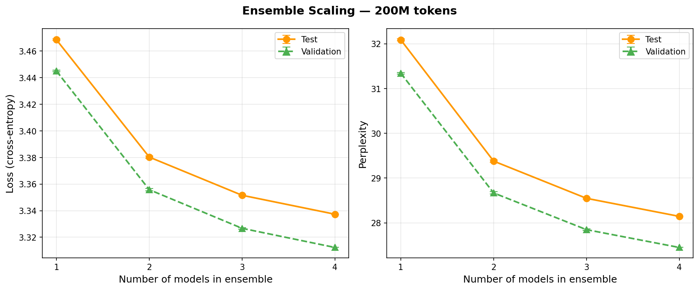
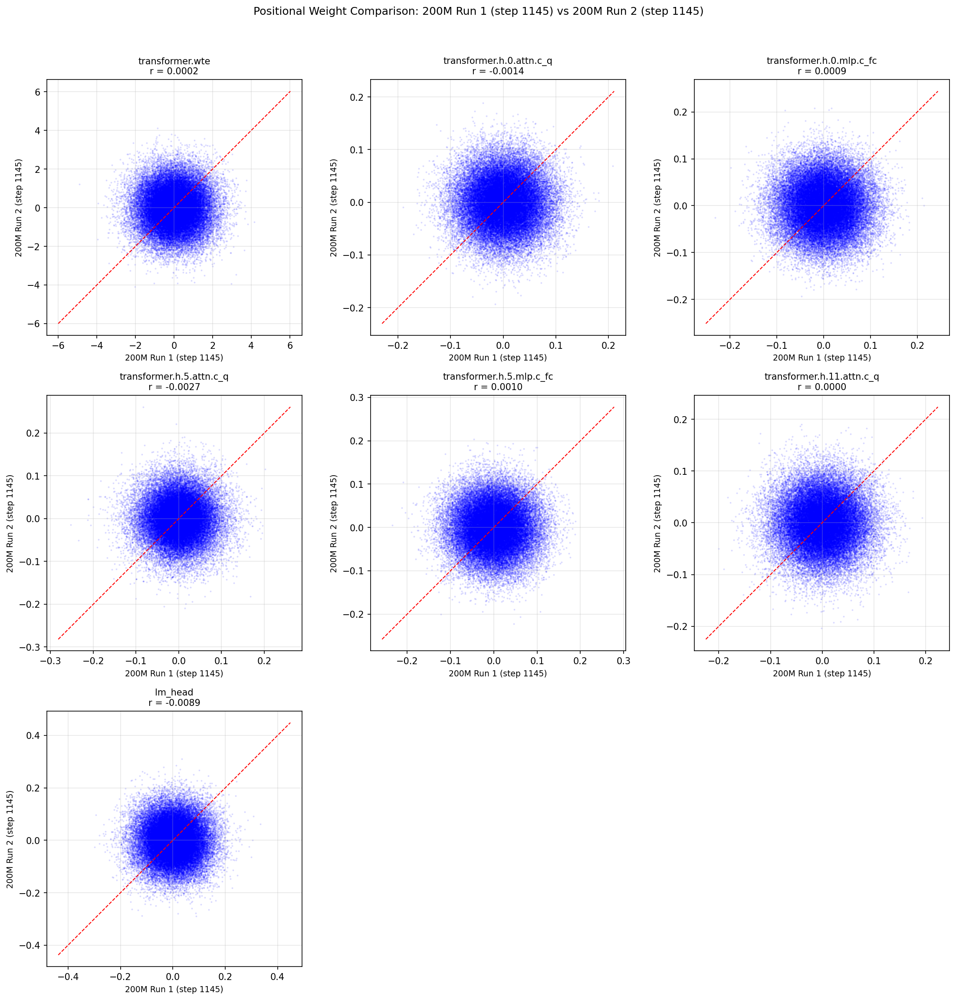

# LLM Training and Ensemble Scaling

Training small GPT-2-style transformer models on FineWeb-Edu and studying how model ensembles improve performance across different training compute budgets.

## Overview

Inspired by [Pre-training under infinite compute](https://arxiv.org/abs/2509.14786) (Kim et al., 2025), this project investigates a simple but effective question: given a fixed training compute budget, how much can you improve language model performance by training multiple independent models and combining their predictions at inference time?

We train 12 models total -- four independent runs at each of three token budgets (50M, 100M, 200M tokens) -- and systematically evaluate all possible ensemble combinations (1, 2, 3, and 4 models). The results show consistent 11--12% perplexity reductions from ensembling, with the largest gains coming from the first additional model.

## Model Architecture

The model is a 162M-parameter GPT-2-style transformer adapted from [modded-nanogpt](https://github.com/KellerJordan/modded-nanogpt), with several modern architectural modifications:

| Component | Detail |
|---|---|
| Parameters | ~162M |
| Layers | 12 transformer blocks |
| Attention heads | 6 |
| Embedding dimension | 768 |
| Sequence length | 1024 |
| Vocabulary | 50,304 (GPT-2 tokenizer) |

Architectural modifications from standard GPT-2:

- **U-Net skip connections** between encoder (first 6 layers) and decoder (last 6 layers), with learned skip weights
- **Rotary Position Embeddings (RoPE)** instead of learned positional embeddings
- **RMS normalization** instead of LayerNorm
- **Squared ReLU** activation (`ReLU(x)^2`) in the MLP
- **QK normalization** -- RMS norm applied to queries and keys before attention
- **Value residual interpolation** -- a learned parameter interpolates between the current and first-layer value vectors
- **Logit soft-capping** -- `30 * tanh(logits / 30)` to bound logit magnitude
- **Learnable residual scaling** -- per-block learnable interpolation between the running hidden state and the initial embedding

## Training

### Optimizer

The project uses a multi-optimizer setup:

- **Muon optimizer** for 2D transformer weight matrices -- applies momentum followed by Newton-Schulz orthogonalization to approximate the nearest orthogonal matrix to the gradient update
- **AdamW** for embeddings (lr=0.15), the language model head (lr=0.002), and scalar parameters (lr=0.01)
- **Warmup** over the first 10 steps, with Muon momentum ramping from 0.85 to 0.95 over 500 steps

### Data

Training data is sourced from [FineWeb-Edu](https://huggingface.co/datasets/HuggingFaceFW/fineweb-edu) (sample-10BT split), tokenized with the GPT-2 tokenizer and stored as binary shards:

- **Train**: 4 shards of 50M tokens each (200M tokens total)
- **Validation**: 1 shard of 4M tokens
- **Test**: 1 shard of 4M tokens

### Experiment Configuration

Three training budgets with four independent runs each (12 models total):

| Budget | Shards | Tokens | Epochs | Runs |
|---|---|---|---|---|
| 50M | 1 | ~50M | 3 | 4 |
| 100M | 2 | ~100M | 3 | 4 |
| 200M | 4 | ~200M | 3 | 4 |

All runs use batch size 128 per device, global batch size 512, and early stopping with patience 3. Training is launched via `run_experiments.sh`.

## Results

### Ensemble Scaling

Ensembles are formed by averaging logits from independently trained models, then computing the loss. For each token budget, all C(4,k) combinations are evaluated for k = 1, 2, 3, 4 models.

#### Test Set Perplexity

| Ensemble Size | 50M Budget | 100M Budget | 200M Budget |
|---|---|---|---|
| 1 model | 47.35 +/- 0.21 | 35.24 +/- 0.18 | 28.72 +/- 0.07 |
| 2 models | 43.75 +/- 0.16 | 32.44 +/- 0.07 | 26.28 +/- 0.05 |
| 3 models | 42.63 +/- 0.09 | 31.57 +/- 0.04 | 25.53 +/- 0.03 |
| 4 models | 42.09 | 31.15 | 25.16 |

#### Validation Set Perplexity

| Ensemble Size | 50M Budget | 100M Budget | 200M Budget |
|---|---|---|---|
| 1 model | 49.27 +/- 0.31 | 36.29 +/- 0.09 | 29.58 +/- 0.05 |
| 2 models | 45.56 +/- 0.20 | 33.45 +/- 0.03 | 27.14 +/- 0.02 |
| 3 models | 44.41 +/- 0.11 | 32.57 +/- 0.02 | 26.39 +/- 0.01 |
| 4 models | 43.84 | 32.14 | 26.03 |

#### Perplexity Reduction (1 model to 4 models, test set)

| Budget | Single Model PPL | 4-Model Ensemble PPL | Reduction |
|---|---|---|---|
| 50M | 47.35 | 42.09 | 11.1% |
| 100M | 35.24 | 31.15 | 11.6% |
| 200M | 28.72 | 25.16 | 12.4% |

Key observations:

- Ensemble gains are consistent across all training budgets (11--12% reduction)
- The largest marginal gain comes from going from 1 to 2 models
- Diminishing returns from 3 to 4 models, but still measurable
- Variance across ensemble combinations decreases with ensemble size, indicating more stable predictions
- Larger training budgets yield lower baseline perplexity, and the relative ensemble benefit is slightly larger

### Ensemble Scaling Plot



### Why Ensembling Works: Weight Diversity

A natural question is: why does averaging logits from independently trained models help at all? To investigate, we compare the learned weights of two 200M-budget models at the same position in each layer (i.e., we scatter-plot `weight_A[i,j]` vs `weight_B[i,j]` for every parameter).



The positional correlations are effectively zero (r < 0.003) across all transformer layers -- attention projections, MLP weights, and the language model head. Despite achieving nearly identical loss, the two models converge to completely different regions of weight space. This means their prediction errors are largely uncorrelated, which is precisely the condition under which ensemble averaging reduces variance.

The one exception is the learned skip connection weights (`skip_weights`), which show r = 0.81. These are scalar per-block parameters that control the U-Net residual interpolation, and their convergence suggests the optimal encoder-decoder coupling ratio is well-determined by the architecture.

Notably, the only source of randomness between runs is weight initialization -- the data shuffle order is identical across all runs (fixed seed). This means the observed diversity is entirely due to different starting points in the loss landscape. Randomizing the data order per run, as suggested by [Kim et al. (2025)](https://arxiv.org/abs/2509.14786), would likely increase model diversity and yield even larger ensemble gains.

Additional weight analysis plots (singular value spectra, effective rank, weight distributions across training budgets) are available in `results/weight_analysis/`. The analysis can be reproduced with `src/analyze_weights.py`.

### A Note on Evaluation Scope

This project focuses on loss and perplexity as the primary metrics for measuring ensemble scaling behavior. These metrics directly capture how well models predict the next token and are well-suited for comparing single models against ensembles in a controlled setting.

Downstream task benchmarks (HellaSwag, ARC, etc.) are not the focus here. In this deliberately undertrained regime -- 162M parameters with only 200M tokens of training data, roughly 16x below compute-optimal ratios -- downstream benchmarks tend to hover near random baselines and do not meaningfully differentiate between models or ensemble strategies. Perplexity is far more sensitive to the gains from ensembling at this scale.

That said, the inference and evaluation tooling in this project (see `src/inference.py` and `src/ensemble_scaling.py`) can be extended with [lm-eval](https://github.com/EleutherAI/lm-evaluation-harness) for downstream task evaluation at larger training budgets.

## Project Structure

```
.
├── src/
│   ├── train.py               # Main training script (Muon optimizer, GPT model, DDP)
│   ├── ensemble_scaling.py    # Ensemble scaling analysis across token budgets
│   ├── inference.py           # Text generation (MPS/CPU/CUDA compatible)
│   ├── analyze_weights.py     # Weight statistics, distributions, singular value analysis
│   └── download_fineweb.py    # Data download and preprocessing
├── results/
│   ├── ensemble_scaling_results.json   # Full ensemble scaling results (all budgets)
│   ├── ensemble_scaling_overlay.png    # Combined scaling plot
│   ├── ensemble_scaling_50m.json       # 50M budget detailed results
│   ├── ensemble_scaling_50m.png        # 50M budget plot
│   ├── ensemble_scaling_200m.json      # 200M budget detailed results
│   ├── ensemble_scaling_200m.png       # 200M budget plot
│   └── weight_analysis/                # Weight diversity and cross-budget comparison plots
├── tutorial.ipynb             # Demo notebook (text generation, results visualization)
├── run_experiments.sh         # Script to run all training experiments
├── requirements.txt           # Python dependencies
└── README.md
```

## Usage

### Prerequisites

- Python 3.10+
- CUDA-capable GPU (required for training)
- ~20 GB disk space for training data

### Setup

```bash
pip install -r requirements.txt
```

### Download Data

```bash
python src/download_fineweb.py
```

This downloads and preprocesses FineWeb-Edu into binary shards under `edu_fineweb_fixed/`.

### Training

Train a single model (50M token budget, 3 epochs):

```bash
python src/train.py --epochs 3 --shards 1 --run-name model_50m_1
```

Train with a larger budget (200M tokens):

```bash
python src/train.py --epochs 3 --shards 4 --run-name model_200m_1
```

Run all experiments (4 runs at each of 3 budgets):

```bash
bash run_experiments.sh
```

Multi-GPU training with DDP:

```bash
torchrun --nproc_per_node=4 src/train.py --epochs 3 --shards 4 --run-name model_200m_1
```

Additional training options:

```bash
python src/train.py --help
```

Key flags: `--val-every N` (validate every N steps), `--sample-every N` (generate text samples during training), `--patience N` (early stopping patience), `--no-wandb` (disable Weights and Biases logging), `--resume PATH` (resume from checkpoint).

### Ensemble Scaling Analysis

Run the ensemble scaling analysis across all token budgets:

```bash
python src/ensemble_scaling.py
```

This evaluates all C(4,k) ensemble combinations for k = 1, 2, 3, 4 models at each budget, saves results to `results/`, and generates scaling plots.

### Inference

Generate text from a trained model:

```bash
python src/inference.py --checkpoint checkpoints/model_200m_1_best.pt --prompt "The meaning of life is"
```

Interactive mode:

```bash
python src/inference.py --checkpoint checkpoints/model_200m_1_best.pt --interactive
```

The inference script is compatible with CPU, MPS (Apple Silicon), and CUDA. It does not require `flex_attention` or `torch.compile`.

### Weight Analysis

Compare weight statistics across checkpoints:

```bash
python src/analyze_weights.py --checkpoints checkpoints/model_50m_1_best.pt checkpoints/model_200m_1_best.pt
```

Pairwise positional weight comparison:

```bash
python src/analyze_weights.py --checkpoints model_a.pt model_b.pt --compare_pairwise
```

## Acknowledgments

This project was inspired by [Pre-training under infinite compute](https://arxiv.org/abs/2509.14786) (Kim et al., 2025), which demonstrates that ensemble scaling is a powerful axis for improving data efficiency in language model pre-training.

The model architecture and training setup are adapted from [modded-nanogpt](https://github.com/KellerJordan/modded-nanogpt). Training data is sourced from [FineWeb-Edu](https://huggingface.co/datasets/HuggingFaceFW/fineweb-edu) by Hugging Face. All training was done using free credits on [Lightning AI](https://lightning.ai/).
